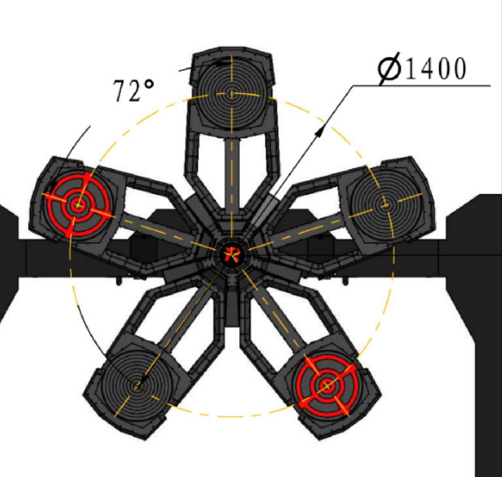
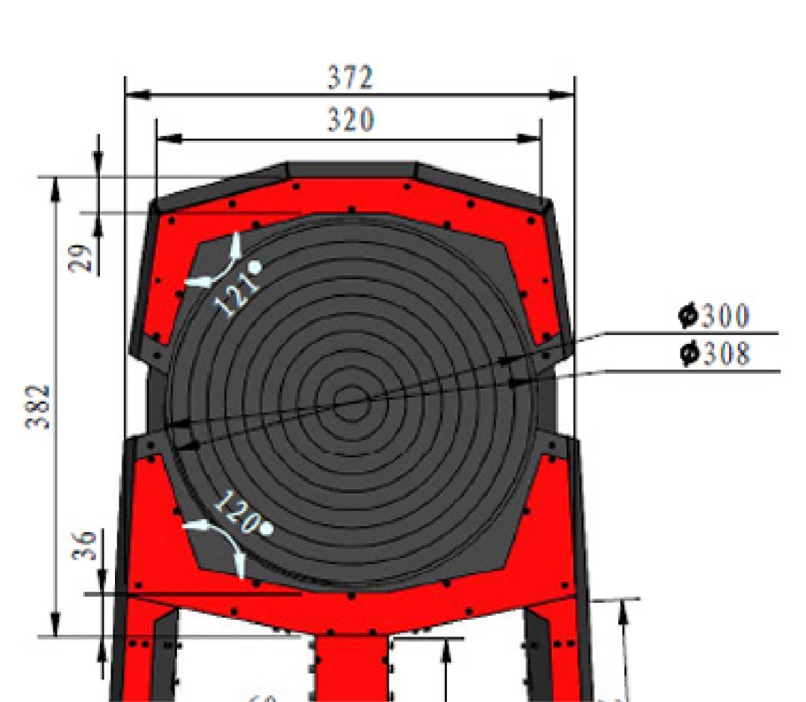
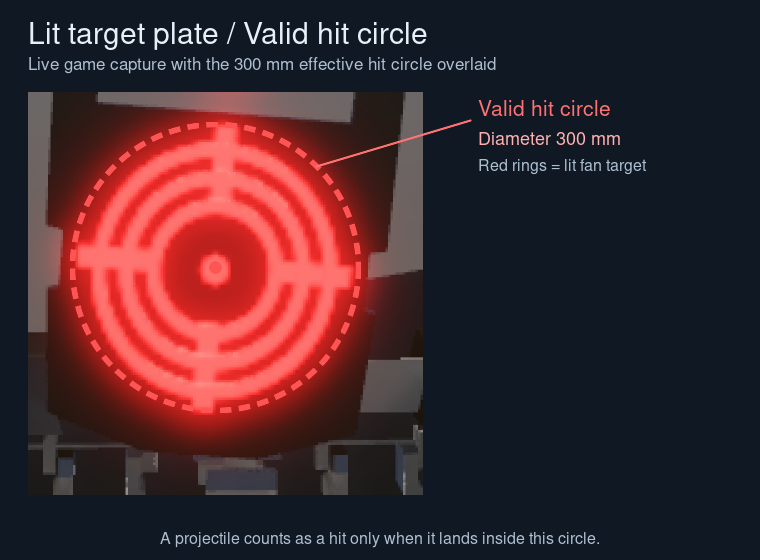

# 能量机关击打仿真（Linux）

本包提供独立运行的仿真程序、ROS 2 相机与云台接口，以及五点角点调试话题；不含 Unity 源工程和自瞄算法。**禁止外传。**

## 启动

需要 Ubuntu 图形桌面、ROS 2 Humble、`colcon` 和系统 Python。建议退出 Conda 环境。解压后在包根目录运行：

```bash
./start_simulator.sh
```

首次启动会构建 ROS 2 消息与中继。相机需要图形渲染，请勿加 `-nographics`。启动脚本会拒绝已有相机中继，以免争抢 UDP 帧。算法终端先执行：

```bash
source /opt/ros/humble/setup.bash
source ros2_ws/install/setup.bash
```

## 游戏操作

| 输入 | 作用 |
|---|---|
| 动条上方。 |
| `M` | 开关鼠标跟随瞄准；默认开启。关闭时鼠标移动不改变云台角度。 |
| `Esc` | 释`R` | 切换旋转状态：周期旋转 → 不旋转 → 匀速旋转 → 周期旋转。默认周期旋转；当前状态显示在相机滑放或重新锁定鼠标，便于操作滑动条。 |
| 方向键 | 手动调整 yaw/pitch；鼠标未锁定时也可用。 |
| `C` | 手动云台角度回到 yaw=0、pitch=0。 |
| 左键、`Space` | 手动发射一发；从相机滑动条开始的左键拖动不会发射。 |
| `P` | 关闭或重新开启当前能量机关；重新开启会重抽周期参数。 |
| `T` | 手动刷新亮靶组合。 |
| `1` / `2` / `3` | 选红方 / 选蓝方 / 兼容的“双方”模式；`3` 实际只激活红方，不会同时点亮重叠的两套模型。 |
| `O` | 保存相机 PNG 到 `RMEnergyHit_Data/StreamingAssets/Screenshots/`；独立版不支持 F1 标签/真值导出。 |

左上角显示发射弹丸数、有效命中数和命中率。下方滑动条可将相机左右移动 `±2 m`、前后移动 `±4 m`、上下移动 `±1 m`；`RESET CAMERA POSITION` 归零。ROS 2 指令在线时云台由外部控制，超过 1 秒未收到指令则恢复手动控制；`M` 不会关闭 ROS 2 接口。

同一时刻最多两块靶面亮起。只有弹丸落在**当前亮靶的圆形有效区域**才计命中，随后切换亮靶；打在其它扇叶、板边缘或未点亮靶面不计命中。

## 旋转规则

| 模式 | 角速度 |
|---|---|
| 不旋转 | `0 rad/s`，保持当前角度。 |
| 匀速旋转 | `π/3 rad/s`，约 `1.0472 rad/s` 或 `60°/s`。 |
| 周期旋转 | `spd(t) = a·sin(ω·t) + b`，单位 `rad/s`。 |

周期模式中，`a ∈ [0.780, 1.045] rad/s`，`ω ∈ [1.884, 2.000] rad/s`，`b = 2.090 − a`，`t` 单位为秒。每次机关进入可激活状态、或从其它旋转模式重新进入周期模式时，`t=0` 并随机抽取新的 `a、ω`；这次运行中参数固定，不额外叠加随机速度噪声。`speed_time_error_limit_s=0.500` 是规则允许的时间误差说明，**不是**程序人为加入的 500 ms 延迟。

## ROS 2 接口

| 方向 | 话题 | 类型 |
|---|---|---|
| 仿真 → 算法 | `/rm_energy/camera/image_raw/compressed` | `sensor_msgs/msg/CompressedImage`，1920×1080 JPEG |
| 仿真 → 算法 | `/rm_energy/camera/camera_info` | `sensor_msgs/msg/CameraInfo`，实时内参 |
| 仿真 → 算法 | `/rm_energy/debug/labels` | `std_msgs/msg/String`，同帧五点角点 JSON（调试真值） |
| 算法 → 仿真 | `/rm_energy/gimbal/command` | `rm_energy_interfaces/msg/GimbalCommand` |

图像和角点建议按 Sensor Data QoS（Best Effort、Keep Last 1）订阅。`GimbalCommand` 含 `header、yaw_rad、pitch_rad、fire`；yaw/pitch 是**相对初始姿态的绝对命令角**，不是增量，正向分别为向右和向上，单位 rad，并受机械限位约束。`fire` 仅在 `false→true` 上升沿请求一发；再次发射须先发布 `false`，并满足发射间隔。ROS 2 中继和 Unity 仅在本机 `127.0.0.1:15000/15001` 通信。

角点 JSON 的每个 `labels` 元素含 `id`（本次运行中的目标标识）、`class_id`（颜色/类别编码）、`hittable`（当前是否有效点亮）、`pixels=[u1,v1,…,u5,v5]`、`hit_offset_object_m`。像素原点位于左上。该话题保留用于已有调试程序的链路验证，不限定算法必须识别这些点；公开参数文件不再提供这五点的排序及三维模型。`hit_offset_object_m` 是内部调试模型原点到圆形命中中心的偏移，不能直接套用到自行建立的模型。JSON 不提供真实相机坐标或距离。角点是 Unity 投影的调试真值，不能用于评估视觉识别能力。

## `config/public_data.yaml` 参数逐项说明

长度单位为米，角度单位为弧度，除非字段另有说明。若实时话题与静态配置不同，以实时话题为准。

| 字段 | 含义 |
|---|---|
| `schema_version` | 文件格式版本。 |
| `ros2.image_topic` / `camera_info_topic` / `command_topic` / `debug_labels_topic` | 四个 ROS 2 话题名：图像、内参、命令、角点。 |
| `ros2.unity_udp_relay_host` / `unity_udp_relay_port` | 云台命令中继送入 Unity 的本机地址/端口，默认 `127.0.0.1:15000`。 |
| `ros2.unity_camera_udp_host` / `unity_camera_udp_port` | Unity 相机流的本机地址/端口，默认 `127.0.0.1:15001`。 |
| `camera.*` / `stream_camera.*` | 两组相同的针孔内参；`stream_camera` 用于 ROS 实时图像，`camera` 为兼容字段，独立版 F1 标签导出未启用。 |
| `frame_id` / `convention` | 相机光学系名称及轴向：右手系，`+x` 右、`+y` 下、`+z` 前。 |
| `width` / `height` / `vertical_fov_rad` | 分辨率 `1920×1080`；垂直视场角 `π/3 rad`（60°）。 |
| `fx` / `fy` / `cx` / `cy` | 像素焦距与主点：`fx=fy=935.307436087`、`cx=960`、`cy=540`。 |
| `K` / `R` / `P` | `CameraInfo` 的 3×3 内参、3×3 单位校正矩阵、3×4 投影矩阵；本相机按无畸变模型使用。 |
| `gimbal_command.unit` / `yaw_definition` / `pitch_definition` | 命令单位、角度零点与正方向。 |
| `gimbal_command.yaw_min` / `yaw_max` | yaw 限位 `±0.69813 rad`（±40°）。 |
| `gimbal_command.pitch_min` / `pitch_max` | pitch 限位 `−0.20944…+0.31416 rad`（−12°…+18°）。 |
| `gimbal_command.initial_camera_elevation_rad` | 零命令时相机光轴初始仰角，约 `0.044079 rad`。 |
| `gimbal_command.initial_yaw_world_rad` | 零命令时世界方位角，约 `1.018504 rad`；不是当前 yaw。 |
| `extrinsics.transform_definition` | `p_camera = R_camera_muzzle · p_muzzle + t_camera_muzzle`。 |
| `extrinsics.gimbal_aim_frame_in_camera_optical` | 虚拟瞄准系相对相机系：`convention` 为同原点同轴；`translation_m=[0,0,0]`，`quaternion_xyzw=[0,0,0,1]`。 |
| `extrinsics.muzzle_in_camera_optical` | 枪口相对相机：`translation_m=[0.08,0.06,0.25]`（右、下、前），`quaternion_xyzw=[0,0,0,1]` 表示无旋转。相机流头另有实时平移。 |
| `ballistics.muzzle_speed_mps` | 弹丸初速度大小 `20.0 m/s`。 |
| `ballistics.gravity_world_mps2` | 公开计算世界系（Z 向上）的重力 `[0,0,-9.81] m/s²`；不要与 Unity 的 Y 向上坐标直接混用。 |
| `ballistics.drag_model` | `none`：不计空气阻力。 |
| `target_geometry.effective_hit_diameter_m` | 圆形有效区域直径 `0.300 m`、半径 `0.150 m`；不是方形外板边长。不指定识别关键点。 |
| `energy_motion.angular_speed_amplitude_range_radps` | 振幅 `a` 的随机范围 `[0.780,1.045] rad/s`。 |
| `energy_motion.angular_frequency_range_radps` | 正弦角频率 `ω` 的随机范围 `[1.884,2.000] rad/s`。 |
| `energy_motion.angular_speed_bias_relation` / `angular_speed_bias_sum_radps` | `b=2.090−a`，常数 `2.090 rad/s`。 |
| `energy_motion.profile_reset` / `speed_time_error_limit_s` | 进入可激活状态时重置时间/参数的规则，及规则允许的 `0.500 s` 时间误差；不是额外噪声。 |

`config/camera_info.yaml` 是内参静态副本，仍建议订阅实时 `CameraInfo`。修改 YAML 不会改变已编译进 Unity 程序的物理规则。

## 模型与命中圆

能量机关的真实物理尺寸以规则手册为准：5 个灯臂均匀分布，相邻灯臂夹角 `72°`，各灯臂靶心分布在 `⌀1400 mm` 的分布圆上。



单块灯臂靶面的真实尺寸：圆靶最大直径 `⌀308 mm`，实际有效检测直径 `⌀300 mm`。



游戏内亮靶实拍如下图，红色圆环图案即亮靶标纹；红色虚线圈为 `⌀300 mm` 有效命中区域，弹丸落入圈内才计命中。



识别特征与 PnP 建模点由算法自行选择，可依据上面的尺寸图建立对应三维点。应保持图像点与三维点一一对应，并自行定义模型坐标系及命中圆心位置；公开配置不指定固定的五个关键点。
